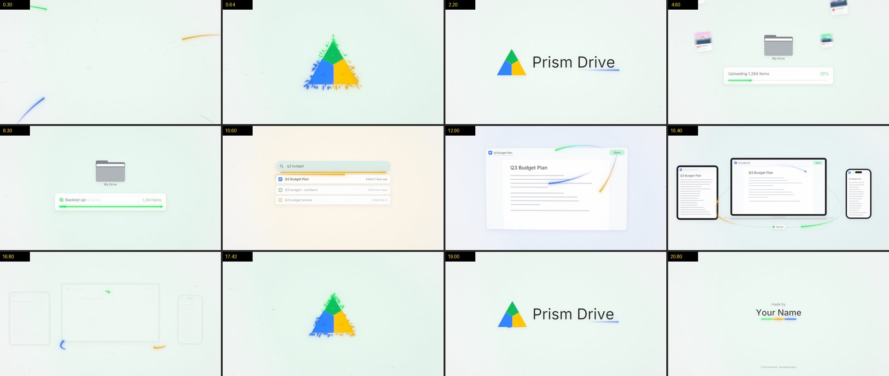
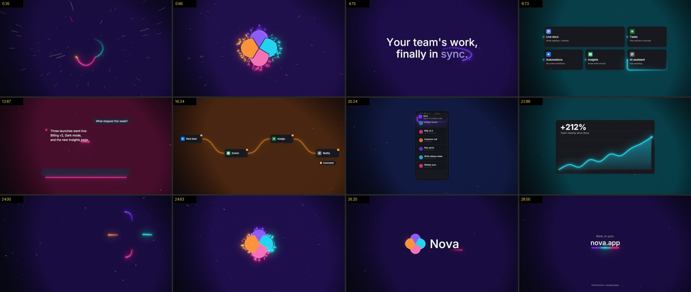

# promo-video

A Claude Code skill that makes broadcast-quality promo videos for any website, app or product,
rendered entirely in code. Give it a URL or a sentence; get back a 1080p60 MP4 with a logo
slam, one continuous light that runs through every scene, rebuilt product UI, a neural
voice-over, an original score with a real drop, and sound design on every move.

No AI video. No stock footage. No templates: Claude directs a different film for every product.

```
/promo-video make one for linear.app
/promo-video 15 second vertical reel for my habit tracker app, dark, hype music
/promo-video launch film for acme.com, Apple style, male voice, use assets/track.mp3
```




## Install

**Option A (recommended): clone the skill folder**

```bash
git clone https://github.com/SushrithKbtech/promo_video_claude_skill ~/.claude/skills/promo-video
python -m pip install -r ~/.claude/skills/promo-video/requirements.txt
```

**Option B: just the SKILL.md.** Save [`SKILL.md`](SKILL.md) as `~/.claude/skills/promo-video/SKILL.md`.
On first use Claude fetches the engine from this repo next to it and installs the Python packages.

You also need:
- Python 3.10+
- [ffmpeg](https://ffmpeg.org/) on your PATH (`winget install ffmpeg`, `brew install ffmpeg`, `apt install ffmpeg`)
- Chrome, Edge or Chromium (used headless to rasterise SVG logos and screenshot websites)
- Internet for the free neural voice (Microsoft Edge TTS). Optional: `ELEVENLABS_API_KEY` for ElevenLabs.

Check everything with `python ~/.claude/skills/promo-video/run.py doctor`.

## What you can ask for

Anything from a bare name to a full brief. Claude fills in the rest:

| you say | it decides |
|---|---|
| a URL | reads the site: copy, colours, fonts, logo, screenshots |
| "15 s", "30 s", "vertical", "square" | duration and 16:9 / 9:16 / 1:1 / 4:5 |
| "dark", "light", "on brand" | the stage: light-as-ink on white, or glow on black |
| "Apple style", "car ad", "hype", "cinematic", "no music" | the score's mood |
| "male voice", "British", "no voice", "use my track" | the voice and music source |
| your script, your screenshots, your product photo | used as-is, timed to the beat |

## What is in the film

**Effects:** lights on soft Beziers with fading tails, light composited as coloured ink on white
or as glow on black, a logo slam with facets that punch in on a spring, 140 shards and camera shake,
a rim light that never stops, a wordmark written by light, the peel into act one, colour hand-overs
along the tail, motion blur on everything that flies, a 3D page warp, homography morphs (a result
row grows into a page, the page flies into a laptop), screens that are real holes, lights that pass
behind devices, whip pans, a race back into the logo on the song's drop, a tri-colour end line with
a glint, pastel or glow stage blobs that breathe, particles, vignette and grain.

**Scenes** (Claude mixes them per product, or writes new ones with the kit):

| scene | the light becomes |
|---|---|
| `upload` | the progress bar as files fly into a folder |
| `search` | the focus line, then the trace around the result |
| `share` | the wait on Share, then live cursors with name flags |
| `devices` | three lights chasing a loop behind laptop, tablet and phone |
| `flow` | the run from node to node (automations, prototypes, pipelines) |
| `chart` | the line being drawn while the number rolls |
| `chat` | the streaming caret of an AI answer |
| `screen` | highlights traced on a real screenshot |
| `statement` | big words written by light, the key word circled |
| `features` | a bento grid traced card by card |
| `phone` | the tap, then the notification |
| `product` | a rim light on a product photo, specular sweep, spec call-outs |

**Real UI:** show your actual product. Screenshots, live pages, or frames pulled from a demo
video go into a browser window that tilts in, while the camera pushes in on each detail, the rest
dims, the light traces it and a label pops in.

**Sound:** an original score written to the picture's beat grid in eight moods (hype, uplifting,
dark, cinematic, chill, house, acoustic, minimal). Every product gets its own song: a seed from the
product picks the progression, key, lead instrument (pluck, FM electric piano, bells, Karplus-Strong
guitar, glass, strings) and drum patterns. About 50 designed sound effects; a voice-over placed so
every key word lands on its beat; ducking; mastered to -14 LUFS with true peak below -1 dBTP. Or
bring your own track: the engine finds its BPM and drop and lands the logo hit on it.

**Made for the product:** the light takes the product's own shape (a heartbeat for health, a sound
wave for audio, circuit traces for dev tools, a route for maps and delivery, a climbing line for
finance) in every transition and in a hero moment, and the sound effects come from a palette that
fits (organic, digital, cinematic, soft, punchy, mechanical, clean), tuned per product.

**You approve the plan:** before rendering, Claude shows a short storyboard (format, scenes, script,
music, voice) and you say yes or change anything.

**No two films alike:** six film formats with different shapes (journey, keynote, launch, story,
showcase, reel), four endings (lights race into the logo, an understated reveal, a hard cut, the
name written by light), logo-first or cold openings, two hooks, light or dark stages, 13 scenes plus
custom ones, six transition types (light hand-over, whip, cut, wipe, push, morph), a score composed per product, and a history of past films so
the director changes the recipe every time.

## How it works

```
capture site -> brief.json (Claude directs) -> voice (key words on beats)
  -> stills + contact sheet (Claude reviews, fixes) -> half-res preview with mix
  -> 1080p60 final in parallel resumable segments -> loudness + stutter checks
```

Picture and sound read one timing model, so every whoosh, key click and impact lands on its frame.
Everything is numpy + OpenCV + Pillow + scipy + ffmpeg. A 22 s 1080p60 film renders in a few
minutes on a laptop.

## Commands

```bash
python run.py doctor
python run.py capture https://example.com ./promo-example
python run.py voice   ./promo-example
python run.py stills  ./promo-example            # key moments + contact sheet
python run.py sheet   ./promo-example --every 0.5
python run.py preview ./promo-example            # 960x540 @ 30 with full mix
python run.py final   ./promo-example            # 1920x1080 @ 60 with full mix
python run.py check   ./promo-example
python run.py music-info my_track.mp3            # BPM + drop time of your own song
```

`examples/` has two fictional brands (light and dark) you can render straight away.

## Spec ads and brands

Spec ads for brands you do not own are portfolio work: the official logo is used untouched, the
UI and data are fictional, and the end card says "Spec ad · not affiliated with <Brand>". For your
own product, use the call-to-action end card.

## License

MIT
